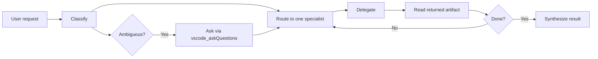

# Budget Optimization Guide

This guide defines how to run the AIgile Budget edition as a disciplined orchestration system instead of a cheap but sloppy chatbot. The target is simple: keep the orchestrator powerful enough to coordinate real work, keep specialist agents bounded and testable, and keep total spend predictable on current GitHub Copilot included/1x-compatible tiers.

The governing stance is strict. Budget edition is not a smaller Enterprise tier with softer rules. It is a different operating mode with harder constraints, tighter schemas, narrower prompts, and explicit escalation when the cheap path becomes unsafe.

The two failure modes this document is designed to prevent are non-negotiable:

- The orchestrator must not solve tasks itself.
- The orchestrator must never hallucinate that it lacks the tools needed to modify the codebase through delegation.

If you adopt the rules below, the Budget edition remains useful on small and mid-size work while avoiding the most common weak-model traps: self-solving, tool hallucination, context bloat, and recursive loops.

## 1. Goals & Non-Goals

Budget optimization is about control, not just cost. The cheapest system is worthless if it burns time by routing badly, rewriting the same prompt, or producing unverified output that humans have to clean up later.

The Budget edition should behave like a strict controller with bounded specialists. It should do less thinking in the orchestrator, more structured delegation, and more deterministic validation.

| Area | Goal | Concrete policy | Success signal |
|---|---|---|---|
| Orchestration | Cheap-but-capable coordination | Keep orchestrator prompts compact and force delegation-first behavior | Most user requests are routed in one pass without self-solving |
| Delegation | Strict delegation contract | Orchestrator never writes code, tests, specs, or file edits | No code-like orchestrator outputs outside control payloads |
| Guardrails | Deterministic behavior on weak models | Use schemas, stop signals, tier pinning, and loop caps | Fewer retries and fewer ambiguous handoffs |
| Spend | Predictable token usage | Enforce per-turn budgets, top-K retrieval, and compressed artifacts | Token usage stays inside configured envelopes |
| Compatibility | Works on current Copilot included/1x tiers | Keep prompts short, retrieval narrow, and outputs JSON-first | Lower-tier models can route reliably without improvising |

### Goals

- Cheap-but-capable orchestration. Budget edition should solve real delivery work by coordinating specialists, not by pretending the orchestrator is a cheaper Enterprise brain.
- Strict delegation contract. The orchestrator exists to classify, route, delegate, track, and synthesize. It does not implement, design, test, or edit.
- Deterministic guardrails. Weak models need hard rails, not friendly reminders. The system should fail closed when routing tier, schema, or validation rules are broken.
- Predictable token spend. Budget mode should make cost legible in advance through line-item caps on prompts, retrieval, subagent returns, and session ceilings.
- Works on current Copilot included/1x tiers. If the rules only work on premium reasoning models, the budget strategy is fake.

### Non-Goals

| Non-goal | Why it is rejected on Budget | What to do instead |
|---|---|---|
| Matching Enterprise depth | Premium-depth reasoning is expensive and not stable on cheap tiers | Escalate only the reasoning-critical step |
| Multi-agent fan-out by default | Parallel fan-out burns tokens and increases merge failures | Use one active specialist at a time unless independence is proven |
| Autonomous architecture decisions on the cheap tier | Weak models make brittle irreversible decisions under pressure | Route architecture to a high-tier planning step |
| Full-repo conversational memory | Replaying history costs more than solving the task | Persist small artifacts and retrieve only top-K evidence |
| Open-ended brainstorming loops | Cheap models drift quickly when goals are fuzzy | Convert ambiguity into questions, assumptions, or stop signals |

The practical interpretation is direct: Budget edition should feel narrower than Full Power, but more predictable. If it is cheap and still noisy, it is not optimized.

## 2. Failure Modes the Doc Must Prevent

Weak models fail in repeatable ways. Treat those failures as system design problems, not personality problems.

| Failure mode | What it looks like | Why it happens | Rule that prevents it |
|---|---|---|---|
| Orchestrator self-solving | The orchestrator answers with code, a design proposal, or direct implementation steps instead of delegating | Weak models confuse task understanding with task execution | Classify -> route -> delegate is mandatory. Any substantive work must be delegated. |
| "I have no tools" hallucination | The orchestrator says it cannot edit files or modify the repo because it lacks tools | Weak models interpret "no file I/O" as "no way to act" | Hard-code the reassurance: it does have `runSubagent`, `vscode_askQuestions`, `todo`, and memory. |
| Context bloat | Full repo dumps, replayed history, repeated file bodies, and giant tool logs | Low-tier models perform poorly when overloaded with irrelevant text | Top-K retrieval only, summaries first, diffs over files, `/clear` between phases |
| Recursive agent loops or fan-out | Orchestrator delegates to a planner, then another orchestrator-like agent, then re-routes again without progress | Weak systems treat delegation as work instead of progress | `max_agent_calls = 4`, `max_rounds = 2`, and no recursive orchestration chains |
| Silent model downgrade on reasoning-critical tasks | Security review or architecture design runs on a cheap model because the runtime quietly swapped tiers | Cost optimization is allowed to overrule correctness if not pinned | Every delegated step carries a required tier. High-tier work must fail closed if downgraded |
| Skipping the Plan phase | Developer receives an under-specified task and guesses the design while coding | Cheap systems try to save tokens by skipping specification | Research -> Plan -> Implement is mandatory unless the task is trivially reversible |

### Short examples of the anti-behaviors

Bad orchestrator self-solving:

```text
I inspected the requirements and wrote the fix below. Update app.js and add this unit test.
```

Bad tool hallucination:

```text
I do not have access to tools that can modify the codebase, so I can only describe the change.
```

Bad context bloat:

```text
Here are the full contents of 18 files so the next agent has enough context.
```

Bad recursive loop:

```text
I will ask the Architect to plan, then ask the Product Owner to restate the plan, then ask the Architect again.
```

Bad silent downgrade:

```text
Security review completed on the default low-cost model.
```

Bad skipped Plan phase:

```text
The requirements look mostly clear, so the developer can infer the edge cases during implementation.
```

Every one of those examples should be logged as an incident, because each one indicates a broken operating contract rather than a harmless stylistic slip.

## 3. Model Routing Table

Budget orchestration works only when model selection matches the GitHub Copilot **premium-request multiplier** of each model. The billable unit is one user prompt multiplied by the model multiplier and any feature multiplier. Tool calls, MCP calls, and subagent fan-out inside one agent-mode turn are not billed separately. The routing table below is therefore organized by tier semantics instead of volatile model names. Concrete labels live in `core/core-config.yaml` and should be reviewed when Copilot availability changes.

| Tier | Multiplier | Routing role on Budget edition |
|---|---|---|
| Included | included / 0x on paid plans | Orchestrator routing, classification, summarization, schema validation, and deterministic/scripted work. |
| Standard | 1x | Bounded implementation, refactor, search/evidence, and routine QA against an approved plan. |
| High reasoning | 3x | Architecture decisions and root-cause debugging on irreversible or repeatedly failing work. |
| Top reasoning | 15x | High-stakes review, threat modeling, security sign-off only. Requires explicit escalation reason. |
| Avoid on Budget | Outside the approved enum or feature-multiplied review flow | Only with platform-owner approval; prefer step-scoped escalation rather than changing the whole workflow. |

### Orchestrator default

The Budget edition should use the cheapest Copilot-compatible model that can reliably perform routing and schema validation for the orchestrator turn. Do not pin a premium model on the orchestrator unless the routing decision itself is reasoning-critical, and even then prefer escalating just the next delegation rather than the orchestrator turn.

### When to escalate

- Escalate when the next decision affects a public API, persistence model, auth boundary, deployment topology, or cross-team contract.
- Escalate after two failed implementation or debugging loops on the same scoped task.
- Escalate when the Plan artifact still contains unresolved assumptions that change behavior, not just naming.
- Escalate for threat modeling, exploit-chain reasoning, secret handling, or compliance-sensitive work.
- Escalate when the blast radius is broad and rollback is expensive.
- Escalate when the user explicitly asks for best-quality reasoning rather than cheapest-safe execution.

### When not to escalate

- Do not escalate for routine routing, summarization, issue triage, or file discovery.
- Do not escalate because a cheap model produced verbose output; fix the schema first.
- Do not escalate to compensate for missing context hygiene.
- Do not escalate if the task is reversible and the guardrails are strong enough to catch mistakes.

### Downgrade policy

Silent downgrade is forbidden. Budget edition should carry tier intent in the delegation payload.

```yaml
required_tier: high
allow_downgrade: false
fallback_action: ask_user
```

If the runtime cannot satisfy the requested tier, it should stop, summarize, and ask the user how to proceed. Quietly swapping a high-tier security review onto a cheap model is worse than refusing to continue.

## 4. Mandatory Delegation Contract

This contract is the core of Budget mode. Without it, the system drifts into a pseudo-autonomous assistant that is expensive, inconsistent, and hard to verify.

### Absolute rules

- The orchestrator NEVER writes code, tests, specs, or edits files.
- The orchestrator NEVER reads the repo directly as a substitute for delegation.
- The orchestrator ALWAYS classifies the request, picks the next specialist, and delegates.
- If routing is unclear, the orchestrator asks a focused human-gate question. It does not guess and it does not self-solve.

### Tool-access reassurance for weak models

Use this exact reassurance in the orchestrator instructions, because weak models need explicit framing:

> You DO have delegation tools (`runSubagent`, `vscode_askQuestions`, `todo`, memory). Through them you modify the codebase. Never claim you lack tools.

That sentence exists to kill the most common Budget-tier hallucination. Do not paraphrase it into softer language.

### Mandatory gating sequence



The sequence is fixed:

1. Classify the task.
2. Route to one specialist.
3. Delegate.
4. Consume the returned artifact only.
5. Either delegate the next bounded step or stop.

Self-solving is not a fallback. It is a contract breach.

### Hard stop rule

If the orchestrator emits more than 12 lines of code, abort and re-route.

The only exception is the approved control payload shapes below. If the orchestrator produces a diff, function body, test case, or prose-heavy technical design, treat that as an incident and force re-routing.

### Canonical delegation envelope

Every automatic orchestration handoff should use the same narrow envelope:

```yaml
agent: Full Stack Developer
task: Implement the approved spec without expanding scope
deliverables:
  - minimal diff summary
  - unit tests
  - guardrail results
context_refs:
  - PLAN-2026-05-27-001
  - FILEMAP-2026-05-27-003
known_context:
  objective: Add behavior X without changing API Y
  constraints:
    - no schema change
    - preserve CLI flags
  stop_signals:
    - new auth requirement discovered
    - more than 5 files need edits
max_return_tokens: 250
required_tier: mid
allow_downgrade: false
```

This envelope is intentionally boring. Budget mode wins by repetition and predictability.

### Human-gate ask pattern

Manual orchestration should gate every delegation with a precise approval payload.

```yaml
tool: vscode_askQuestions
questions:
  - header: delegate-implement
    question: Approve delegation of implementation to Full Stack Developer?
    message: |
      Proposed task: implement the approved plan only.
      Deliverables: diff summary, unit tests, guardrail results.
      Stop if more than 5 files are touched or the plan is incomplete.
    options:
      - label: Proceed
        recommended: true
      - label: Modify task
      - label: Choose another agent
      - label: Skip
      - label: Abort
    allowFreeformInput: true
    multiSelect: false
```

The human gate is not ceremony. It is how Budget mode prevents a cheap orchestrator from freewheeling through unclear work.

### Runtime rejection criteria

Reject an orchestrator turn if any of the following are true:

- It contains a diff marker such as `+`, `-`, or `@@` in a code block.
- It contains a fenced block longer than 12 lines that is not an approved control payload.
- It names a specialist task but does not actually delegate it.
- It says or implies that the orchestrator cannot act because it lacks repo-editing tools.
- It chains multiple dependent delegations in one turn without user approval.

Budget mode should enforce this mechanically, not socially.

## 5. Research -> Plan -> Implement Workflow Mapped to AIgile Agents

Budget mode stays coherent by separating discovery from decision and decision from implementation. That split is what keeps mid-tier coding models from inventing requirements during execution.

| Phase | Primary agent | Default tier | Main output | Consumed by | Stop signal |
|---|---|---|---|---|---|
| Research | Business Analyst or Architect | Low, with low-mid search assist when needed | File map, assumptions, open questions, risk hints | Plan | Missing domain fact that changes behavior |
| Plan | Architect or Product Owner | High | Precise spec, acceptance criteria, boundaries, stop signals | Implement | Irreversible decision still unresolved |
| Implement | Full Stack Developer | Mid | Code diff, tests, validation evidence | QA | Plan ambiguity, broad file churn, failed tests |
| QA | Test Architect & Quality Advisor | Mid by default, high on risky review | Test report, lint result, defect list, go or no-go | User or follow-up implement step | Blocking defects or unverified behavior |

### Workflow principles

- Research is about evidence, not solutions.
- Plan is about decisions, not code.
- Implement is about executing the approved plan, not re-negotiating it.
- QA is about verification, not wishful trust in the developer summary.

### Example artifact shapes

Research artifact:

```json
{
  "artifact_id": "RESEARCH-2026-05-27-001",
  "objective": "Map the files and assumptions for the requested change",
  "files": [
    {"path": "src/router.ts", "reason": "entry point"},
    {"path": "src/budget.ts", "reason": "current budget logic"}
  ],
  "assumptions": [
    "No schema migration is expected",
    "Existing CLI behavior must remain stable"
  ],
  "open_questions": [
    "Is fallback behavior user-visible?"
  ],
  "ready_for_plan": true
}
```

Plan artifact:

```json
{
  "artifact_id": "PLAN-2026-05-27-001",
  "scope": "Implement budget routing safeguard without changing public API",
  "acceptance_criteria": [
    "Orchestrator always delegates implementation work",
    "Weak models never claim tool absence",
    "Unit tests cover guardrail behavior"
  ],
  "constraints": [
    "No new dependencies",
    "Touch at most 5 files"
  ],
  "stop_signals": [
    "Public API contract appears inconsistent",
    "Auth or persistence changes are required"
  ],
  "handoff_target": "Full Stack Developer"
}
```

Implementation artifact:

```json
{
  "artifact_id": "IMPL-2026-05-27-001",
  "plan_ref": "PLAN-2026-05-27-001",
  "changed_files": [
    "src/orchestrator.ts",
    "test/orchestrator.test.ts"
  ],
  "diff_summary": [
    "Added hard stop for code-like orchestrator output",
    "Added explicit tool-access reassurance"
  ],
  "tests_added": [
    "rejects self-solving output",
    "rejects tool-hallucination text"
  ],
  "guardrails": {
    "unit_tests": "pass",
    "lint": "pass",
    "security_scan": "pass"
  },
  "needs_followup": false
}
```

QA artifact:

```json
{
  "artifact_id": "QA-2026-05-27-001",
  "implementation_ref": "IMPL-2026-05-27-001",
  "checks": [
    {"name": "unit tests", "status": "pass"},
    {"name": "lint", "status": "pass"},
    {"name": "semgrep", "status": "pass"}
  ],
  "defects": [],
  "verdict": "go",
  "notes": "Acceptance criteria satisfied"
}
```

### Handoff rule

Each phase should pass the next phase an artifact reference plus a short known-context block, not the entire prior transcript. A Budget-tier system should move forward on compact state, not reheated conversation history.

### 5-Phase Trajectory Model

Bai et al. (2026) decomposed agentic coding runs into a five-phase trajectory that is more useful as a budget-gate model than the abstract Research/Plan/Implement/QA split alone. Use it as an instrumentation taxonomy on top of the four AIgile phases.

| Phase | What happens | Token signature |
|---|---|---|
| Setup | Load task, fetch initial context, register tools | Output-token spike (plan emission) |
| Explore | Search, read files, follow references | Input dominates; context grows fastest |
| Fix | Edit, run tests, iterate on failures | Input dominates; Fix + Explore together account for roughly two-thirds of all rounds |
| Validate | Run guardrails, scans, verification | Mixed; bounded if scoped |
| Closeout | Summarize, write report, hand off | Output-token spike (synthesis) |

Use phase boundaries as **budget-gate checkpoints**: snapshot tokens consumed, turns used, and tool-call counts on each transition. A run that is still in Explore after 60 percent of its turn budget is a candidate for early stop. Source: Bai et al. 2026, https://arxiv.org/abs/2604.22750.

## 6. Context Engineering Rules

Most budget failures are context failures. Cheap models do not need more text. They need better selection.

> Note on terminology. In this document, "per-turn budget" refers to a quality and latency envelope, not a billing envelope. GitHub Copilot bills one premium request per user prompt times the model multiplier times any feature multiplier. Tokens are not the billing unit. Token caps below exist to keep cheap models accurate and prompt caches warm, not because tokens are charged. See section 16 for the actual cost model.

### Core rules

| Rule | Default | Why | Allowed exception |
|---|---|---|---|
| Top-K retrieval | K <= 5 | Cheap models degrade fast on irrelevant context | Increase only for high-tier planning with explicit reason |
| Summaries first | Always | Summary preserves routing signal while controlling spend | Read full file only if summary says it is decisive |
| Diffs over full files | Always for edit review | Most edit tasks care about change, not entire file body | Full file only when surrounding control flow matters |
| `/clear` between phases | Required | Prevents replayed history from polluting later steps | Skip only if the runtime already isolates phase context |
| Known context block | Required on every prompt | Gives the model a stable, reusable scaffold | None |
| Per-turn budget | Mandatory | Forces predictable spend and terse returns | None |
| Compression rules | Mandatory for internal artifacts | Cuts narrative waste while keeping evidence | Never compress user-facing deliverables into shorthand |

### Known context block

Prepend a block like this to every agent prompt:

```yaml
known_context:
  task_id: TASK-2026-05-27-001
  phase: implement
  objective: Keep budget orchestration powerful but cheap
  accepted_assumptions:
    - orchestrator may delegate but never self-solve
    - tests are mandatory for dev output
  pinned_artifacts:
    - PLAN-2026-05-27-001
    - RESEARCH-2026-05-27-001
  pinned_files:
    - core/data/orchestrator-routing.md
    - core/instructions/agent-comms.skill.md
  excluded_context:
    - full repo dump
    - full chat transcript
  stop_signals:
    - public API change discovered
    - more than 5 files required
```

This block does three jobs:

- It tells the model what is already settled.
- It names the only evidence the model should trust.
- It explicitly blocks irrelevant context that would tempt the model to wander.

### Retrieval order

Use the cheapest retrieval path that can answer the question:

1. Ripgrep when you know the string, path, or symbol name.
2. Tree-sitter or symbol-aware slicing when you need exact control-flow neighborhood.
3. Semantic store top-K retrieval when the concept is fuzzy but still bounded.
4. Full file reads only after one of the first three paths proves they are necessary.

### Compression rules

- Preserve exact filenames, commands, errors, test names, and decisions.
- Remove repeated background explanation once it has been accepted.
- Convert long tool logs into verdict plus evidence excerpt.
- Keep internal subagent returns at 250 tokens by default.
- Keep max tool-result summaries under 800 tokens in Budget mode.
- Never replay the full chat history to a new phase.

### Suggested per-turn budget

| Budget slice | Default cap | Notes |
|---|---|---|
| Orchestrator instructions and known context | 1200 tokens | Keep stable to maximize caching |
| Retrieved context | 2000 tokens | Top-K summaries only |
| Subagent return | 250 tokens | Raise only when evidence demands it |
| Guardrail report | 400 tokens | Status plus failing evidence |
| Final synthesis | 500 tokens | User-facing summary, not transcript |

That keeps a typical Budget turn inside a roughly 4350-token envelope before overhead, which is tractable on cheap models and far easier to predict than open-ended prompting.

### Quadratic token growth in multi-turn agents

LLM APIs are stateless. Every turn re-sends the full conversation plus tool manifest plus all prior tool outputs. A naive 10-turn agent does not consume 10x a single-turn cost; it consumes roughly 5.5x because each turn re-sends every earlier turn. Empirically, a 10-turn coding agent loop runs around **27,500 cumulative input tokens** even when each individual turn looks small. Treat turn count as a quadratic cost driver, not linear.

### Input-token dominance

Agentic coding workloads are overwhelmingly input-bound, not output-bound. Two anchor data points:

- Claude Code telemetry: **99.4 percent input tokens**, 0.6 percent output.
- Bai et al. 2026 across eight frontier models on SWE-bench Verified: **input-to-output ratio of 153.85** for code-reasoning agents.

This flips the intuition from chatbot workloads (where output tokens dominate cost). For coding agents, **trimming input is where the savings are**, and the ET formula in section 16 weights output 4x precisely because output is the more expensive *per token*, not because there is more of it.

### Mitigation triad

Three compounding techniques, in priority order:

1. **Rolling LLM summarization of evicted turns** — summarize old turns into a short recap and drop the raw transcript. Reported 50-70 percent context reduction on long-horizon agents.
2. **Tool-output trimming and eviction** — cap per-tool-call output size, evict old observations behind a placeholder once they fall outside a rolling window. JetBrains (Dec 2025) found observation masking alone cut cost by over 50 percent with no solve-rate loss.
3. **Dynamic / lazy tool loading by phase** — only register tools the current phase will use. Explore phase loads search and read tools; Fix phase loads edit and test tools; Closeout loads no tools. Avoids paying for tool schemas the agent will not call.

Sources: Bai et al. 2026; JetBrains Research, Dec 2025, https://blog.jetbrains.com/research/2025/12/efficient-context-management/.

## 7. MCP / Tooling Stack Recommendations

Budget optimization needs a tooling stack that reduces prompt width before it asks the model to think harder. The sequence matters: search narrowly, extract the right slice, compress the evidence, then delegate.

Use plain-text repo names when you are not certain of the canonical URL. Do not paste guessed URLs into docs, prompts, or config. For Caveman MCP in particular, look up the actual repo under the rtk-ai GitHub org before pinning a URL.

| Tool | What it does | When to use it | When NOT to use it | Budget stance |
|---|---|---|---|---|
| Caveman MCP | Local embeddings, code-aware chunking, context compression | Default retrieval layer for Budget tier when semantic search is helpful and you want compact context bundles | Do not use it to replace exact keyword search or to dump large chunks back into the prompt | Preferred semantic retrieval and compression entry point |
| Qdrant | Vector store for local or repo-scale semantic retrieval | Use when you want local-first semantic search and predictable embedding control | Do not add it if the repo is small enough for ripgrep plus targeted reads | Strong default for local Budget deployments |
| Weaviate | Semantic retrieval with hybrid search options | Use when your team already runs Weaviate or needs hybrid retrieval features | Do not run both Qdrant and Weaviate on a small Budget deployment without a clear reason | Acceptable alternative, not a mandatory companion |
| Tree-sitter | AST extraction and precise symbol context | Use when the next agent needs exact function, class, or call-site neighborhoods | Do not send full ASTs to a cheap model; slice only the needed symbol neighborhood | High-value precision tool |
| Ripgrep | Fast keyword and path lookup | Use first when the symbol name, file name, or literal string is known | Do not force semantic search for exact matches | Cheapest and often best first pass |
| rtk-ai/rtk | Shell output cleanup and normalization | Use when command output is noisy and would otherwise bloat the context window | Do not add it when output is already small and human-readable | Good budget hygiene for terminal-heavy flows |
| jsturtevant/copilot-codeact-plugin | Collapses predictable multi tool-call chains | Use when the same search-read-edit-validate pattern repeats and tool chatter is dominating cost | Do not adopt it blindly if the plugin hides decision points you need to audit | Useful when workflows are repetitive and well-structured |
| `/chronicle tip` | Captures agent misses for the instruction log | Use after incidents, repeated confusion, or prompt drift | Do not spam it for every successful turn | Essential for continuous tightening of Budget prompts |

### Recommended stack order

1. Use Ripgrep for exact strings, known files, and path patterns.
2. Use Tree-sitter for symbol-level precision when the next agent needs structure.
3. Use Qdrant or Weaviate for semantic top-K retrieval, not both by default.
4. Use Caveman MCP to compress and package retrieved context for cheap models.
5. Use rtk-ai/rtk to collapse noisy shell output before it reaches the model.
6. Use jsturtevant/copilot-codeact-plugin only after you have stable workflows worth collapsing.
7. Use `/chronicle tip` to record what the system missed so prompts get tighter over time.

### Practical guidance

- Pick one semantic store. Running two on the budget tier is usually operational vanity.
- Prefer local retrieval and local compression before hosted reasoning.
- Keep AST extraction behind a strict slice boundary. Cheap models do not benefit from raw parse-tree floods.
- If a tool increases prompt width more than it reduces search effort, it is not a Budget tool.

### MCP Tool Pruning Rule

Every registered MCP tool costs schema tokens **every turn**. LLM APIs are stateless and runtimes re-send the full tool manifest on each call. Tools you never invoke still bill input tokens for the life of the workflow.

Verified numbers from GitHub Blog (May 2026):

- GitHub MCP server (40 tools) = **10-15 KB of schema per turn**.
- Removing unused tools from smoke-test workflows: **-8-12 KB per call**, several thousand tokens per run, no behavior change.
- Real case: the Glossary Maintainer workflow called `search_repositories` **342 times per run**, 58 percent of all tool calls, completely unnecessary for a local-file-scan workflow. Removing it eliminated the dominant tool-call cost.
- Counter-case: the Daily Community Attribution workflow had 8 unused GitHub MCP tools with 0 calls, but removing them did not reduce effective tokens (ET) because in that workflow the tool manifest was a small fraction of total context. Tool-pruning wins are workflow-specific; measure before and after.

Rule: enforce per-agent allow-lists, and **cross-reference the registered tool manifest against actual tool-call logs**. Anything registered but never called is dead weight. Anything called orders of magnitude more than expected is a workflow design bug, not a model bug.

Source: GitHub Blog, May 2026 — https://github.blog/ai-and-ml/github-copilot/improving-token-efficiency-in-github-agentic-workflows/.

## 7a. CLI Substitution Pattern

Replacing GitHub MCP calls with `gh` CLI invocations is **structurally larger** than tool pruning, not just a variant of it. The reason is round-trip cost: an MCP tool-use is a reasoning step (the LLM decides to call, formulates arguments, then ingests the response back into context as a full conversational turn). A `gh pr diff` invocation is deterministic HTTP with **no LLM involvement** — the workflow runner does the call and the agent sees the result as a file or shell output, not as a conversational round-trip.

Two strategies:

1. **Pre-agentic data downloads.** For data the agent will always need (PR diffs, changed file lists, issue metadata, label scans), run `gh` in workflow setup steps, write the result to workspace files, then let the agent read the files. The agent uses its native bash-scripting fluency to process them. This eliminates the tool-call overhead entirely.
2. **In-agent CLI proxy substitution.** For runtime-decided fetches, a lightweight transparent HTTP proxy routes CLI traffic to the GitHub API without exposing the auth token to the agent. The agent runs `gh pr view --json`, gets structured data back, and the zero-secret invariant is preserved.

Verified results (GitHub `gh-aw` portfolio, April-May 2026):

- Auto-Triage Issues: **-62 percent** ET / 109 post-fix runs
- Security Guard: **-43 percent** ET
- Smoke Claude: **-59 percent** ET

Source: GitHub Blog May 2026 (same URL as above).

## 8. Per-Agent Optimization

Budget edition tunes each agent for one narrow role, one compact prompt pattern, one JSON output schema, one default model tier (expressed as a multiplier), and one explicit escalation rule. The table below is the canonical per-agent contract. Default model tiers are expressed as Copilot premium-request multipliers so that routing decisions stay billing-aware.

| Agent | Role on Budget edition | Cheap-mode prompt pattern | Output schema (JSON) | Default model tier | Escalation trigger |
|---|---|---|---|---|---|
| Orchestrator (Automatic) | Classify, route, delegate, track, synthesize. Never perform specialist work. | `Known context: {{known_context}}. Budget auto orchestrator. Choose exactly one next specialist, never solve the task yourself, and output one delegation JSON object only.` | `{"next_agent":"Business Analyst","task":"map files and questions","context_refs":["RESEARCH-001"],"stop_signals":["schema change"],"required_tier":"included","escalate":false}` | GPT-5 mini (0x, included) | Architecture, security, repeated failed loops, or ambiguity that changes behavior |
| Orchestrator (Manual) | Same as automatic orchestration, but every delegation is human-gated. | `Known context: {{known_context}}. Budget manual orchestrator. Ask via vscode_askQuestions before every delegation, then emit one approved delegation JSON object.` | `{"approval_needed":true,"question_header":"delegate-plan","proposed_agent":"Architect","proposed_task":"turn research into a bounded plan","required_tier":"high","escalate":false}` | GPT-5 mini (0x, included) | User-approved route conflicts with safety constraints, or the requested step is reasoning-critical |
| Architect | Turn research into a narrow technical plan with acceptance criteria, boundaries, and stop signals. Decide constraints, not implementation. | `Known context: {{known_context}}. Act as the Architect. Use the research artifact only. Produce a minimal plan, acceptance criteria, boundaries, and stop signals. Output JSON only.` | `{"decision":"add explicit orchestration guardrails","acceptance_criteria":["no self-solving","no tool hallucination"],"constraints":["no API change"],"stop_signals":["auth boundary affected"],"needs_escalation":false}` | Claude Opus 4.5/4.6 (3x). Pinned, never via Auto. | Public API, persistence, auth, topology, or other irreversible decisions that warrant Opus 4.6 (15x) |
| Full Stack Developer | Implement exactly the approved plan. Keep diffs minimal, add unit tests, run guardrails. | `Known context: {{known_context}}. Act as the Full Stack Developer. Implement only the approved plan, do not expand scope, add unit tests, run guardrails, and output JSON plus artifact ids.` | `{"changed_files":["src/orchestrator.ts","test/orchestrator.test.ts"],"tests_added":["guardrail tests"],"commands":["npm test","npm run lint"],"guardrails":{"unit_tests":"pass","lint":"pass","security_scan":"pass"},"blocked":false}` | Claude Sonnet 4.5/4.6 or GPT-5.4 (1x, 0.9x via Auto) | Plan incomplete, more than 5 files needed, or two repair loops fail |
| Test Architect & Quality Advisor (QA) | Verify the implementation against the plan, expand coverage where needed, refuse sign-off without evidence. | `Known context: {{known_context}}. Act as QA. Validate the implementation artifact against acceptance criteria, run tests and scans, and output JSON only.` | `{"checks":[{"name":"unit tests","status":"pass"},{"name":"lint","status":"pass"},{"name":"semgrep","status":"pass"}],"defects":[],"verdict":"go","incident_logged":false}` | Claude Sonnet 4.5/4.6 (1x, 0.9x via Auto) | Critical gaps, flaky evidence, or risky behavior outside the approved plan -> escalate review to Opus 4.6 (15x) |
| Business Analyst | Build the file map, assumptions, and open questions needed for planning. Reduce ambiguity, do not invent solutions. | `Known context: {{known_context}}. Act as the Business Analyst. Map relevant files, constraints, assumptions, and open questions. Output JSON only.` | `{"objective_summary":"clarify budget orchestration behavior","files_to_read":["core/data/orchestrator-routing.md"],"assumptions":["compressed prompts already exist"],"open_questions":[],"ready_for_plan":true}` | GPT-5 mini (0x) or Haiku 4.5 (0.33x) when reasoning is needed | Product ambiguity that changes behavior, pricing model, or success criteria |
| Security Engineer | Analyze threat boundaries, review findings, stop unsafe changes from slipping through because coding was cheap. | `Known context: {{known_context}}. Act as the Security Engineer. Review auth, secret, validation, and trust-boundary risks. Use high-tier reasoning when needed. Output JSON only.` | `{"assets":["agent routing rules","tool access contract"],"findings":[],"required_actions":[],"residual_risk":"low","block_release":false}` | Claude Opus 4.6 (15x). Pinned, never via Auto. | Always escalation-eligible: auth, crypto, PII, secrets, sandbox escape, compliance |
| DevOps Engineer | Handle CI, deployment, runtime config, rollback, and environment drift. | `Known context: {{known_context}}. Act as the DevOps Engineer. Scope only CI/CD, runtime config, rollback, and environment validation. Output JSON only.` | `{"affected_surfaces":["CI workflow","pre-commit hooks"],"change_plan":["run lint","run tests","run semgrep"],"rollback":["revert workflow change"],"blocked":false}` | Claude Sonnet 4.5/4.6 (1x, 0.9x via Auto) | Production migration, cross-environment rollout, or data-plane risk -> escalate to Opus 4.5/4.6 (3x) |
| UX Expert | Map user flows, friction points, and measurement plans. Do not generate broad vision prose. | `Known context: {{known_context}}. Act as the UX Expert. Map the user flow, friction points, and success metrics. Output JSON only.` | `{"user_flow":["request","delegate","verify","report"],"pain_points":["unclear approval prompts"],"measurement":["approval completion rate","incident frequency"],"needs_research":false}` | GPT-5 mini (0x) or Sonnet 4.5 (1x, 0.9x via Auto) for richer flow mapping | Conflicting persona needs, information architecture changes, or irreversible workflow redesign |
| UI Expert | Define component states, visual constraints, and accessibility expectations. | `Known context: {{known_context}}. Act as the UI Expert. Define states, visual constraints, and accessibility requirements. Output JSON only.` | `{"components":["budget mode banner"],"states":["default","warning","error"],"accessibility":["announce incident state"],"needs_design_review":false}` | GPT-5 mini (0x) or Sonnet 4.5 (1x, 0.9x via Auto) | New design system, brand-level change, or high-risk interaction redesign |
| Product Manager | Sequence work, define slices, keep delivery risk visible. Narrow execution order, not implementation. | `Known context: {{known_context}}. Act as the Product Manager. Sequence the work into minimal safe slices, track dependencies and release risk, and output JSON only.` | `{"goal":"stabilize Budget orchestration","milestones":["guardrails","tests","incident tracking"],"dependencies":["approved plan","QA gate"],"recommended_mode":"standard"}` | GPT-5 mini (0x) | Cross-team dependency, hard deadline, or release-blast-radius decision |
| Product Owner | Translate the plan into precise acceptance criteria, non-goals, and done conditions. | `Known context: {{known_context}}. Act as the Product Owner. Write acceptance criteria, non-goals, and done conditions from the approved scope. Output JSON only.` | `{"story":"Budget orchestrator remains delegation-only","acceptance_criteria":["no self-solving","no tool hallucination"],"non_goals":["Enterprise-depth autonomy"],"done_conditions":["tests pass","incidents logged"]}` | GPT-5 mini (0x) | Conflicting stakeholder intent, missing business rules, or unclear release scope |
| Scrum Master | Keep the workflow from looping, stalling, or violating phase order. Process control, not delivery ownership. | `Known context: {{known_context}}. Act as the Scrum Master. Track blockers, approvals, phase order, and next checkpoints. Output JSON only.` | `{"current_phase":"implement","blockers":[],"decision_needed":false,"next_checkpoint":"QA sign-off","loop_risk":"low"}` | GPT-5 mini (0x) | Repeated loops, approval confusion, or workflow debt that blocks delivery |

### Per-agent rules that apply to everyone

- Output JSON first. Narrative comes second, if at all.
- Respect the known context block. Do not re-open settled decisions.
- Stop and escalate when a stop signal fires. Do not improvise past it.
- Return artifact ids and compact evidence, not verbose transcripts.
- Tier choices above are Copilot premium-request multipliers, not abstract labels. Implementation work must not exceed 1x without a written escalation reason. See section 18 for the billing-aware routing contract.

## 9. Loop Control & Budget Limits

Cheap orchestration fails hardest when nobody notices the loop soon enough. Budget mode therefore needs fixed caps.

```yaml
max_agent_calls: 4
max_rounds: 2
turn_budget_alerts: [50, 80, 100]
session_token_ceiling: 180000
```

> Important: these caps are **quality and latency caps, not billing caps.** GitHub Copilot bills one premium request per user prompt times the model multiplier times any feature multiplier. Tool calls, MCP calls, and subagent fan-out inside one agent-mode turn are not billed separately. The only thing that adds to the premium-request count is a fresh user prompt (or a separately-billed feature such as Copilot code review or the cloud coding agent). `max_agent_calls` exists to prevent runaway loops and stale context, not to cap dollars. See sections 16 and 20 for the actual billing model.

### Hard limits

- `max_agent_calls = 4` means a request can involve at most four specialist delegations before the orchestrator must stop and checkpoint.
- `max_rounds = 2` means at most two implementation-repair rounds on the same scoped task.
- Budget alerts should fire at 50 percent, 80 percent, and 100 percent of the configured turn budget.
- When loop detection triggers, the system should auto-halt, summarize, and ask for a narrower next move.

### Stop conditions

Stop the workflow when all three are true:

- The required schema is valid.
- Tests and other guardrails pass.
- No open questions remain that affect behavior.

If any one of those is false, the task is not done.

### Loop detection rules

| Signal | Example | Required action |
|---|---|---|
| Same agent, same goal, same context twice | Two identical developer retries | Stop and escalate or ask for scope change |
| Same open question appears after Research and Plan | Requirements ambiguity survived planning | Return to Product Owner or user, not to Dev |
| Same files are touched in two failed loops with different guesses | Dev is searching blindly | Escalate debugging or tighten the plan |
| Repeated claims of missing context | Agent keeps asking for more files | Cut the task smaller or improve retrieval |
| Orchestrator proposes parallel dependent work | Fan-out is being used as a substitute for clarity | Reject and serialize the workflow |

### Session ceiling guidance

Set a per-session token ceiling even if the individual turns look small. A common failure pattern is cheap turns that accumulate into an expensive, low-quality day. A strong default for Budget mode is 180k total tokens per user session, with stricter ceilings for Economy mode and higher ceilings only for explicit Deep mode.

### Loop caps as quality features

Hard caps and early-stop-on-no-progress are **quality** features, not only cost features. They defend against two failure shapes:

- **Inverse test-time scaling** (Bai et al. 2026): accuracy peaks at intermediate cost and *declines* at maximum cost. Burning more turns past the peak makes the answer worse, not just more expensive.
- **Runaway fallback loops** from misconfigured deterministic tools (see §14 anti-patterns). An agent denied a fast deterministic path will substitute slow LLM exploration, often for dozens of turns.

Tie loop caps to the §5 5-phase model: a workflow still in Explore after 60 percent of its turn budget is a candidate for early stop. The cheapest LLM call is the one you do not make — add a **relevance gate** that short-circuits the LLM entirely when input fails a deterministic precondition. Real case: the Security Guard workflow added a relevance gate that skips the LLM for PRs not touching security-sensitive files, contributing to its -43 percent ET reduction.

## 9a. Prompt Caching Tiers

Prompt caching is the single biggest optimization lever available at the API layer. Major providers offer steep discounts on cached input:

- **Anthropic**: cached input ~90 percent cheaper than fresh input.
- **DeepSeek**: cached input ~90 percent cheaper.
- **OpenAI**: cached input ~50 percent cheaper.

The ET formula in section 16 weights cache reads at **0.1x** of fresh input to reflect this. A 10 percent reduction in fresh input by moving content into a cacheable prefix can yield a much larger ET reduction.

Cache-friendly prompt design: **stable prefix → volatile suffix**. Put system prompt, tool schemas, and long pinned context at the top in a fixed order; put the per-turn user message and dynamic state at the bottom. Every reordering of the prefix invalidates the cache.

Caveat: cache reads dominate total token *volume* on long agentic runs even at 80x cheaper per-token rates (Bai et al. 2026). Caching shifts the cost curve, it does not eliminate input dominance. You still need the §6 mitigation triad (rolling summarization, output trimming, lazy tool loading) on top of caching.

## 10. Deterministic Guardrails

Guardrails are what make Budget mode safe. Without them, the savings come from skipping verification, which is not optimization.

### Required guardrails

- Unit tests are required for any Dev output that changes executable behavior.
- Linter and formatter checks run before sign-off.
- A security scan such as Semgrep runs on any code change.
- Each agent invokes the relevant guardrails before returning its artifact.
- Failures are logged as incidents, not blindly retried until the model gets lucky.

### Guardrail matrix

| Guardrail | Trigger | Owner | Required evidence | Failure action |
|---|---|---|---|---|
| Unit tests | Any code change | Full Stack Developer and QA | Test names and pass or fail status | Stop implementation loop and log incident |
| Linter | Any source edit | Full Stack Developer and QA | Lint command and failing file list if any | Fix if local, otherwise stop and report |
| Formatter | Any source edit in formatted repos | Full Stack Developer | Formatter result or no-op confirmation | Apply once, then continue |
| Security scan | Any code or config change | QA or Security Engineer | Semgrep or equivalent report | Block release on critical findings |
| Schema validation | Any agent artifact | Every agent | JSON shape validation result | Reject artifact and retry once with tighter prompt |
| Diff sanity | Any implementation artifact | QA | Files changed vs planned scope | Block if scope exceeded |

### Minimal guardrail payload

```json
{
  "guardrails": {
    "unit_tests": {"status": "pass", "evidence": ["orchestrator guard tests"]},
    "lint": {"status": "pass", "evidence": ["eslint clean"]},
    "security_scan": {"status": "pass", "evidence": ["semgrep no findings"]}
  },
  "incident_logged": false
}
```

### Retry policy

One automatic retry is acceptable only when the failure is clearly caused by missing context, a bad schema, or a trivial formatting defect. Do not let a cheap model brute-force quality by repeating the same step with slightly different words.

## 11. Memory & Artifacts Strategy

Budget mode needs memory, but only the right kind. Storing everything is another form of context bloat.

### Layering order

Always resolve context in this order:

1. Instructions
2. Memory
3. Artifacts
4. Retrieved context

That order matters because instructions define the contract, memory stores stable preferences, artifacts store prior work, and retrieved context fills gaps. Reversing the order makes the system too eager to let fresh retrieval override durable rules.

### Memory and artifact table

| Layer | Purpose | Retention | What belongs there | What does not |
|---|---|---|---|---|
| Short-term scratchpad | Per-task working notes | Clear per phase | current phase assumptions, temporary blockers, next action | entire transcripts |
| `copilot-instructions.md` | Non-negotiable operating rules and miss log | Long-lived | hand-written rules, incidents, recurring failure fixes | AI-generated essays |
| Artifact store | Durable task outputs referenced by id | Per task or per epic | spec, diff summary, test report, security report | raw full-file dumps |
| Copilot Memory | Stable user or repo preferences | Long-lived | naming preferences, preferred test commands, stable constraints | volatile task state |

### Artifact strategy

- Persist specs, diff summaries, and test reports by artifact id.
- Pass artifact ids and short summaries between phases.
- Keep artifacts immutable once consumed by later phases; create a new version instead of mutating history.
- Store only the evidence needed to reproduce or audit a decision.

### Hand-written miss log

The `copilot-instructions.md` file should contain the system's durable non-negotiables and a short miss log. That miss log should be hand-written by humans after reviewing incidents. Do not auto-generate it with the same system that is being corrected.

Good miss-log entries are short:

- `2026-05-27: Budget orchestrator claimed it lacked tools. Added explicit reassurance sentence and hard rejection rule.`
- `2026-05-28: Developer received under-specified task. Added mandatory Plan artifact before implementation.`

## 12. Observability & Incident Log

If you cannot see where the budget is going, you are not managing a Budget edition. Observability is part of cost control.

### What to track

| Metric | Why it matters | Owner | Alert condition |
|---|---|---|---|
| Tokens per agent per turn | Shows which role is actually burning budget | Orchestrator runtime | Unexpected spike vs norm |
| Tokens per completed task | Measures effective cost, not just raw usage | Product and platform owners | Cost per task rising without quality gain |
| Incidents by failure mode | Finds prompt and workflow weaknesses | Team lead or platform owner | Same miss repeats twice |
| Escalation rate | Ensures Budget mode is not pretending to be Full Power | Platform owner | High-tier steps become the norm |
| Loop rate | Reveals poor stop signals or vague artifacts | Scrum Master or platform owner | More than one loop on routine tasks |

### Incident log template

```text
date: 2026-05-27
agent: Budget Orchestrator
mode: standard
miss: Claimed it had no tools to modify the codebase
impact: User received a false blocker instead of a delegation
fix: Added explicit tool-access reassurance and runtime rejection rule
artifact_refs: [INC-2026-05-27-003]
owner: platform
status: closed
```

### Operating cadence

- Use `/chronicle` regularly to find repeated misses and high-cost paths.
- Treat agent misses as incidents even when a human quickly recovers the workflow.
- Run a weekly review over incidents, cost spikes, and escalation patterns.
- Update instructions after the review, not during the middle of a noisy task.

### Cost dashboard thresholds

At minimum, expose threshold alerts for:

- 50 percent of session budget consumed
- 80 percent of session budget consumed
- 100 percent of session budget consumed

Budget mode should not surprise operators with a quiet cost overrun.

### Token capture and joint metrics

Instrumenting cost correctly is a prerequisite for every other optimization in this doc. Three rules:

- **Capture at the API-proxy layer.** Different CLIs (Claude Code, Copilot CLI, Codex) emit different telemetry shapes. Normalize at the proxy so you have one format across all of them. Emit a `token-usage.jsonl` artifact per run with fields: `input`, `output`, `cache_read`, `cache_write`, `model`, `provider`, `timestamp`.
- **Track joint metrics, not single metrics.** Watch `tokens_per_LLM_call` AND `LLM_calls_per_run` together. Constant turns + falling tokens-per-call = real efficiency win. Both falling = scope reduction; the agent may simply be doing less or worse work. A single-metric dashboard cannot distinguish these.
- **Track process-level quality proxies.** Output-tokens-per-call, turns-per-run, and tool-call completion rate. If all three are stable across an optimization, the optimization did not visibly degrade behavior. Caveat: these are process signals, not outcome quality; pair them with the §10 guardrails (tests pass, lint clean, scans clean) before declaring a win.

**Workload-shift confounder.** The Contribution Check workflow showed ET **+5 percent** post-optimization, which initially looked like a regression. Disaggregation revealed the PR-size distribution had shifted: small PRs dropped 41 percent → 9 percent, large PRs rose 39 percent → 65 percent. Output tokens (weighted 4x in ET) rose 14 percent because the workload itself got heavier, not because the workflow got worse. Always disaggregate ET by workload bucket before declaring a win or loss.

Source: GitHub Blog May 2026 (same URL).

## 12a. Auditor + Optimizer Workflows

Two paired agentic workflows, scheduled daily, that close the feedback loop on token spend:

- **Daily Token Usage Auditor.** Reads token-usage artifacts from recent runs, aggregates by workflow, flags workflows with significant usage increase, surfaces the most-expensive workflows, and notes anomalous runs (e.g. a workflow that normally uses 4 LLM turns took 18).
- **Daily Token Optimizer.** When the Auditor flags a workflow, the Optimizer reads the workflow source plus recent logs, then opens a GitHub Issue with concrete inefficiencies and a specific proposed optimization (e.g. "remove unused MCP tool X", "move issue-metadata fetch into pre-agentic step", "add relevance gate on file path Y").

Both are themselves agentic workflows and appear in their own daily reports — a virtuous cycle that surfaces drift in the auditors themselves. Require a human approval gate before merging any Optimizer suggestion; do not let one agent silently rewrite another agent's prompt.

Source: GitHub Blog May 2026.

## 13. Execution Modes

Budget edition should expose a few explicit operating modes instead of one vague "cheap mode". That keeps the trade-offs obvious.

| Mode | Model policy | Agent count | Retrieval K | Escalation | Best for | Avoid for |
|---|---|---|---|---|---|---|
| Economy | Low tier only | 1 agent | 3 | None | Tiny, reversible tasks, narrow routing, simple summaries | Security review, architecture, broad edits |
| Standard | Mixed tier | <= 2 agents | 5 | Allowed | Most day-to-day feature and bug work | Wide cross-cutting changes without a plan |
| Deep | High-tier planning plus full workflow | <= 4 agents | 5 | Expected when needed | High-risk, multi-phase, low-reversibility work | Routine chores and simple file updates |

### Mode heuristics

Use Economy when all three are true:

- The task is narrow.
- The blast radius is low.
- The work is easily reversible.

Use Standard when any of these are true:

- The task touches code and tests.
- The repo slice is non-trivial.
- You need one specialist plus QA.

Use Deep when any of these are true:

- The task changes architecture, security, or deployment boundaries.
- The blast radius is high.
- The change is hard to reverse.

Default to Standard. Economy should be a conscious optimization, not the default just because it is cheaper on paper.

## 14. Anti-Patterns Checklist

Do not tolerate these behaviors in Budget mode. If any one appears, stop the run and log an incident.

- DON'T let the orchestrator write code.
- DON'T accept "I have no tools" as a valid orchestrator reply.
- DON'T dump full files into context when summaries or diffs would do.
- DON'T skip the Plan phase just to save one agent call.
- DON'T replay full chat history into each new phase.
- DON'T let AI generate `copilot-instructions.md` or the miss log.
- DON'T run parallel subagent fan-out on Budget tier without explicit user approval.
- DON'T escalate silently without logging why the cheap path was rejected.

### Additional anti-patterns from 2025-2026 field data

- **Inverse test-time scaling** — accuracy peaks at intermediate cost and declines at maximum cost. More turns and bigger models past the peak make the answer *worse*, not just more expensive. Cap turns and verify with §10 guardrails rather than assuming "more compute = better". (Bai et al. 2026.)
- **Replit re-read** — re-loading the entire project on trivial actions. Reported case: a one-button-color change cost roughly $1 because the agent re-read the full project context. Cache the project map; only re-read changed slices.
- **Redundant exploration loops** — repeated file view-then-modify-then-view patterns on the same file are the signature of failed high-cost runs (Bai et al. 2026). Detect with tool-call deduplication; treat as a stop signal.
- **Runaway fallback loops from misconfigured tool allowlists** — real case: the Daily Syntax Error Quality workflow's bash allowlist permitted only relative-path globs, so `gh aw compile` on `/tmp/` paths was always blocked. The agent fell into a **64-turn loop** manually reading source files to reconstruct compiler output. A one-line allowlist fix eliminated the loop. **Lesson: when an agent loops, suspect a blocked deterministic tool before suspecting the LLM.**
- **Carrying unused tools** — the Glossary Maintainer case (`search_repositories` called 342 times per run on a workflow that never needed it, 58 percent of all tool calls). Always cross-reference the registered tool manifest against actual tool-call logs.

The system should prefer a clean stop over a low-quality continuation. Cheap and wrong is still expensive.

## 15. Quickstart (7 Things to Do Today)

1. Pick the right model per task using the routing table.

Default the orchestrator to **GPT-5 mini** (0x multiplier, included on every paid plan) and **enable Auto mode for specialist coding agents** to take the 10 percent discount on 1x-multiplier models. Do not start with the cheapest premium model and hope for the best. Start with the included tier for routing, push implementation to 1x via Auto, and reserve 3x (Opus 4.5/4.6) and 15x (Opus 4.6) for architecture, root-cause debugging, and security review with an explicit escalation reason.

2. Set a $0 overage budget and configure alerts.

In GitHub Copilot billing settings, set the premium-request overage budget to $0 by default and enable alerts at 75, 90, and 100 percent of the monthly quota. That makes the request-based cost model fail closed instead of silently charging $0.04 per overage request. See section 21 for the full hygiene checklist.

3. Add stop signals and known context to every prompt.

If a model has to infer what is already settled, what is out of scope, or when it should stop, the prompt is under-specified. Add a known-context block and explicit stop signals before tuning anything else.

4. Enforce Research -> Plan -> Implement.

This is the single biggest quality improvement for Budget mode. Cheap coding models perform well when they execute a good plan and poorly when they guess their own requirements.

5. Wire tests, linter, and security scans as guardrails.

Budget savings are real only when validation is automated. Add unit tests for behavior changes, lint and formatter checks for mechanical quality, and Semgrep or an equivalent scan for security hygiene.

6. Consolidate work into agent-mode turns instead of re-prompting.

One agent-mode turn with many tool calls is one premium request. Five separate ask-mode prompts on the same task are five premium requests. Bundle clarifications, file reads, edits, and validation into the same turn whenever possible. See section 20 for the consolidation pattern.

7. Maintain a hand-written `copilot-instructions.md` as your agent-miss log.

When the system misses, capture the failure in one or two sharp lines and turn it into a durable rule. That log is how Budget mode gets better without growing into another bloated prompt.

### First-week rollout checklist

| Day | Action | Expected outcome |
|---|---|---|
| Day 1 | Add delegation contract and tool-access reassurance | Orchestrator stops self-solving and stops hallucinating tool absence |
| Day 2 | Enforce known-context blocks and top-K retrieval | Prompt width drops and routing gets cleaner |
| Day 3 | Require Plan artifacts before Dev work | Fewer implementation guesses and fewer repair loops |
| Day 4 | Add guardrail reporting and incident logging | Quality and cost become visible |
| Day 5 | Review incidents with `/chronicle` and tighten prompts | Budget mode becomes more deterministic over time |

Budget optimization is not one trick. It is a stack of disciplined constraints that make cheap models predictable enough to be useful.

## 16. Premium Request Economics

The GitHub Copilot billing unit is the **premium request**, not the token and not the tool call. The formula is:

```text
premium_requests_charged = 1 user prompt
                          * model_multiplier
                          * feature_multiplier
```

A "user prompt" is one fresh request from the user inside Copilot Chat, agent mode, edits, code completions in eligible IDEs, or any other surface that GitHub bills as a premium-eligible interaction. Everything the agent does inside that single turn (tool calls, MCP calls, file reads, subagent fan-out, retries within the same turn) is **not separately billed**. Only the next user prompt starts the next billable unit.

### Monthly quotas and overage

| Plan | Monthly premium requests | Overage |
|---|---|---|
| Copilot Free | 50 | Not available |
| Copilot Pro | 300 | $0.04 per request once enabled |
| Copilot Pro+ | 1500 | $0.04 per request once enabled |
| Copilot Business | 300 per user | $0.04 per request once enabled |
| Copilot Enterprise | 1000 per user | $0.04 per request once enabled |

Quotas reset on the first of each month at 00:00 UTC. Unused requests do not roll over. Overage is charged only after a non-zero overage budget is configured by the user or admin; the default is $0.

### Effective Tokens (ET) as the engineering metric

The premium-request multiplier is the **billing unit**, but it is the wrong unit for engineering optimization: it does not differentiate input from output, does not credit caching, and does not let you compare workflows across model tiers. For engineering, use **Effective Tokens (ET)**:

```text
ET = m * (1.0 * I + 0.1 * C + 4.0 * O)

m: model multiplier (Haiku 0.25, Sonnet 1.0, Opus 5.0)
I: fresh input tokens
C: cache-read tokens
O: output tokens
```

Rationale (per GitHub Blog May 2026): output is weighted **4x** because it is the most expensive token type across providers. Cache is weighted **0.1x** because cache reads are served at a small fraction of fresh-input cost (see §9a). A **10 percent ET reduction = a real 10 percent cost reduction regardless of which model the workflow runs on**, which is what makes ET useful as an apples-to-apples engineering metric across the portfolio.

Keep the premium-request multiplier table above as the billing-facing unit; use ET as the engineering-facing unit. See §23 glossary for the canonical definition.

### Verified results (GitHub `gh-aw` and `gh-aw-firewall`, April-May 2026)

| Workflow | ET reduction | Post-fix runs | Notes |
|---|---|---|---|
| Auto-Triage Issues | -62% | 109 | Moved deterministic reads (issue metadata, label scans) into pre-agentic CLI steps |
| Daily Compiler Quality | -19% | 12 | |
| Community Attribution | -37% | 8 | |
| Security Guard | -43% | ~190 | Added relevance gate: skip LLM for PRs not touching security-sensitive files |
| Smoke Claude | -59% | ~190 | Aggressive MCP pruning + model switch to Haiku |
| Contribution Check | +5% | — | Workload shift, not regression (small PRs 41%->9%, large PRs 39%->65%; see §12) |

Auto-Triage's optimization saved roughly **7.8 million ET in aggregate** over the observation period. Run-frequency multiplied by per-run savings matters as much as per-run percent: Auto-Triage runs 6.8 times per day, Daily Compiler Quality once per day, so a -62% on the first dominates a -19% on the second even though both look like "good wins" on a per-run dashboard.

Per-role cost spread, for orientation: a chatbot turn is roughly $0.001 per task; a coding agent turn is $8+ per task. The "Replit problem" — a $1 button-color change caused by a full project re-read — is the canonical example of how a careless coding agent dwarfs a careful chatbot. See §14 anti-patterns.

Two consequences follow:

- Routing and orchestration on GPT-5 mini are effectively free up to the monthly cap, because the orchestrator's multiplier is 0x.
- The biggest savings come from **collapsing prompts into agent-mode turns** and pruning unused tools, not from shaving prose. A 15-tool-call Opus 4.5 turn is still 3 premium requests; the same work split across 5 user prompts is 15 premium requests.

## 17. Auto-mode Policy

GitHub Copilot's Auto model selection applies a flat 10 percent discount on the model multiplier and is restricted to models with a multiplier of 1x or lower. Auto will therefore never select Opus 4.5/4.6, Opus 4.6, GPT-5.5, or Gemini 3.5 Flash. It can select Sonnet 4.5/4.6, Gemini 2.5/3.1 Pro, GPT-5.2/5.2-Codex/5.3-Codex/5.4, and any of the included models.

### Use Auto for

- Full Stack Developer implementation against an approved plan.
- QA validation runs.
- DevOps configuration changes within an approved envelope.
- UX/UI specialists when reasoning depth is not the bottleneck.
- Any specialist whose default tier in the section 8 table is 1x.

### Do not use Auto for

- Architect (3x, pinned). Auto would silently drop the tier and break the irreversible-decision contract.
- Security Engineer (15x, pinned). The whole point of pinning Opus 4.6 is to refuse downgrade.
- Reasoning-critical planning that requires GPT-5.5 (7.5x).
- Any step with `allow_downgrade: false` in its delegation envelope.

When in doubt, the rule is: Auto is correct for **bounded execution**, and incorrect for **decisions that must be made at a guaranteed reasoning tier**.

## 17a. Budgeting Under Variance

Agentic coding budgets are not point estimates. Bai et al. (2026) measured up to **30x run-to-run variance on identical tasks**. Five consequences for how Budget edition sizes envelopes:

- **Budget as p50/p95 distributions, not point estimates.** A workflow whose median run costs 10k ET but whose p95 costs 200k ET needs a 200k ET ceiling and a 10k ET target. Reporting only the mean hides the tail.
- **Human-rated difficulty only weakly predicts agent cost** (Kendall τ ≈ 0.32). Do not size budgets from human estimates; size them from observed token distributions.
- **Models systematically underestimate their own token use** (self-prediction correlation 0.21-0.39). An agent asked "how many tokens will this take?" is unreliable. Require an external meter (§12). Never gate budgets on agent self-prediction.
- **Workload variability dominates per-workflow variance.** The same workflow may handle a 5-line fix one run and a 200-line PR the next. Disaggregate ET by workload bucket (PR size, issue type, file count touched) before claiming an efficiency win or regression.
- **Prioritize by (per-run ET × run frequency), not per-run alone.** Auto-Triage at 6.8 runs/day × 62 percent reduction dominates Daily Compiler Quality at 1 run/day × 19 percent reduction by roughly an order of magnitude in absolute ET saved.

Sources: Bai et al. 2026; GitHub Blog May 2026.

## 18. Billing-aware Routing Rules

Budget edition pins a per-turn premium-request ceiling per task category. Implementation work must not exceed 1x without an explicit escalation reason. Opus 4.6 (15x) requires `escalation_reason` to be populated and must be approved through the manual orchestrator's human gate.

| Task category | Max multiplier per user prompt | Allow downgrade via Auto | Escalation reason required |
|---|---|---|---|
| Orchestration (routing, classification, synthesis) | 0x (included) | Yes (Auto stays included) | No |
| Research (file map, assumptions, open questions) | 0.33x | Yes | No |
| Planning (architecture decisions) | 3x | No | If exceeded |
| Reasoning-critical planning | 7.5x | No | Yes |
| Implementation (Dev, DevOps, QA validation) | 1x (0.9x via Auto) | Yes | If exceeded |
| Security review and threat modeling | 15x | No | Yes, always |
| Copilot code review feature | Disabled on Budget | n/a | Re-enable only with platform-owner approval |

### Extended delegation envelope

The canonical envelope in section 4 must add four billing-aware fields on Budget edition:

```yaml
agent: Full Stack Developer
task: Implement the approved spec without expanding scope
deliverables:
  - minimal diff summary
  - unit tests
  - guardrail results
context_refs:
  - PLAN-2026-05-27-001
known_context:
  objective: Add behavior X without changing API Y
  stop_signals:
    - new auth requirement discovered
    - more than 5 files need edits
max_return_tokens: 250

# Billing-aware fields (Budget edition)
required_tier: implementation        # routing | research | implementation | architecture | security
max_multiplier: 1.0                  # hard ceiling for this delegation
allow_downgrade: true                # Auto mode may pick a 0.9x model
escalation_reason: null              # must be a non-empty string if max_multiplier > 1.0
```

### Rejection rules

- Reject any delegation where `max_multiplier > 1.0` and `escalation_reason` is null or empty.
- Reject any delegation where `required_tier: security` and `max_multiplier < 15.0`.
- Reject any delegation where `required_tier: architecture` and `allow_downgrade: true`.
- Reject any delegation where `required_tier: implementation` and `max_multiplier > 1.0` without an escalation reason that names a stop signal that fired.

These rules enforce the section 3 routing table mechanically, so a cheap orchestrator cannot quietly upgrade a routine implementation step to Opus 4.6.

## 19. Feature-Multiplier Awareness

Beyond model multipliers, several GitHub Copilot features apply their own multipliers or live in separate billing buckets. Budget edition must account for all of them.

| Feature | Multiplier or billing | Budget edition stance |
|---|---|---|
| Copilot code review on PRs | 13x times the underlying model multiplier, effective June 1, 2026 | Disable by default. Route review through agent-mode chat sessions, which are billed as one premium request per prompt instead of 13x per review. |
| Copilot cloud coding agent | 1 premium request per session times the model multiplier. Dedicated SKU since November 1, 2025. | Use only for long-running, well-scoped tasks where the single-session billing is cheaper than equivalent interactive turns. Track in a separate ledger. |
| Copilot Spark | 4x | Avoid on Budget edition unless the workflow genuinely needs Spark. Prefer plain chat. |
| Data residency and FedRAMP on Enterprise | Adds approximately 10 percent on top of underlying multipliers | Treat all multipliers as 1.1x their nominal value when costing Enterprise budgets. |
| Inline code completions in eligible IDEs | Billed under the same premium-request model when the underlying model has a non-zero multiplier | Stay on included models (GPT-5 mini family) for completions wherever possible. |

The single highest-impact Budget recommendation in this section: **disable Copilot code review for Budget edition tenants** and run reviews as agent-mode chat turns instead. The 13x feature multiplier turns one Sonnet 4.5 review into 13 premium requests, which dominates the monthly quota faster than any other single setting.

## 20. Turn Consolidation Pattern

Because billing is per user prompt and not per tool call, the cheapest workflow is one agent-mode turn with many tool calls rather than many ask-mode prompts.

### Before (4 premium requests on Sonnet 4.5 via Auto = 3.6)

```text
User prompt 1: "Read src/orchestrator.ts and tell me what it does."
User prompt 2: "Now add a guardrail that rejects code-like output."
User prompt 3: "Add unit tests for the new guardrail."
User prompt 4: "Run npm test and report results."
```

### After (1 premium request on Sonnet 4.5 via Auto = 0.9)

```text
User prompt 1 (agent mode):
"In one turn:
 1. Read src/orchestrator.ts.
 2. Add a guardrail that rejects code-like output.
 3. Add unit tests for the new guardrail.
 4. Run npm test and report results.
 Stop signals: more than 5 files touched, or auth boundary affected."
```

Both flows do roughly the same work, but the consolidated version costs 25 percent of the premium requests because tool calls and subagent fan-out inside one agent-mode turn are free.

### Consolidation rules

- Group reads, edits, tests, and validation into one agent-mode turn whenever scope is clear.
- Use the canonical delegation envelope to define the whole turn up front, including stop signals.
- Reserve ask-mode prompts for genuinely new decisions, not for nudging the agent through a known sequence.
- Do not consolidate across phase boundaries (Research, Plan, Implement, QA). Each phase still warrants its own turn so that artifacts can be reviewed.

## 20a. Codified Multi-Agent Prompts (CodeAgents)

Free-form natural-language plans are token-expensive and structurally noisy. The CodeAgents framework (Yang et al. 2025) replaces them with **pseudocode plans**: typed variables, explicit control flow (loops, conditionals), subroutines, assertions, and a replan loop. Roles are split into **Planner**, **ToolCaller**, and **Replanner**, each driven by a codified YAML system prompt rather than a prose persona.

Measured on GAIA, HotpotQA, and VirtualHome benchmarks:

- **Input token usage: -55 to -87 percent** vs natural-language prompting baselines.
- **Output token usage: -41 to -70 percent.**
- Task-accuracy gains of 3-36 percentage points (not a tradeoff — token efficiency and accuracy improved together).

This is the cleanest available evidence that prompt **structure**, not just prompt length, drives token cost for multi-agent reasoning. The §8 per-agent JSON schemas already point in this direction; CodeAgents formalizes the same idea for inter-agent planning.

Source: Yang et al. 2025, https://arxiv.org/abs/2507.03254.

## 21. Quota and Overage Hygiene

Budget edition depends on the quota model being legible and fail-closed. Configure each tenant the same way.

### Defaults

- Set the premium-request overage budget to **$0**. No surprise charges; the system fails closed when the monthly quota is exhausted.
- Enable alerts at **75, 90, and 100 percent** of the monthly quota.
- For Business and Enterprise, enable per-user alerts in addition to org-level alerts so that one heavy user does not silently consume the shared envelope.

### Weekly and session limits (effective April 20, 2026)

GitHub added tighter weekly and session-based usage limits on Pro, Pro+, and Student plans on April 20, 2026. These limits apply **independently of the monthly premium-request quota**. A user can hit a session limit and be temporarily rate-limited even though they still have unused monthly requests. Budget edition must treat these as real ceilings:

- Plan delivery so that no single user is parked on one model for multi-hour bursts.
- Spread Opus 4.5/4.6 and Opus 4.6 work across sessions when possible.
- If a session limit is hit, stop the workflow and resume in the next session rather than re-prompting in a tight loop.

### Reset behavior

- Monthly premium-request quotas reset on the first of each month at 00:00 UTC.
- Unused requests **do not roll over**. Plan delivery so you neither sandbag the quota nor sprint into the last day.
- Overage charges accrue continuously once the quota is exhausted and a non-zero overage budget is set. They are billed in the standard GitHub billing cycle.

### Operating checklist

- Confirm the overage budget is set to $0 unless a platform owner has explicitly opted in.
- Confirm alerts at 75/90/100 percent are enabled.
- Confirm that Copilot code review is disabled on the tenant.
- Confirm that the orchestrator default model is an included model (GPT-5 mini family).
- Confirm that Auto mode is enabled for specialist coding agents.
- Confirm that high-multiplier models (Opus 4.6, GPT-5.5, Gemini 3.5 Flash, Opus 4.6 fast) require an explicit escalation reason.

## 21a. Efficient Context Management

Four techniques, each independently validated, that should be standard on any long-horizon agentic workflow:

- **Sliding window over turn history.** Keep the most recent N turns in full; replace older turns with placeholders. JetBrains (Dec 2025) found a 10-turn window optimal for SWE-agent on SWE-bench Verified; tune per agent scaffold.
- **Rolling LLM summaries of evicted turns.** When a turn falls out of the window, summarize it into a short recap rather than dropping it entirely. Reported cost reduction over 50 percent vs unbounded context, with no solve-rate loss.
- **Retrieval-augmented context.** Inject only step-relevant files into the prompt rather than the full repository or full transcript. Pair with the §7 tooling stack (Ripgrep → Tree-sitter → semantic store).
- **Per-tool output size caps with on-demand re-fetch.** Cap each tool's returned context (e.g. file reads truncated to N KB, test output to verdict + failing assertions). The agent can re-fetch the full output explicitly when needed.

Caveat: observation masking and LLM summarization both work and both halve cost vs unbounded context; the JetBrains study found masking alone often beats summarization because summarization itself burns tokens and tends to elongate trajectories. Start with masking; layer summarization only when context still grows unbounded.

Source: JetBrains Research, Dec 2025, https://blog.jetbrains.com/research/2025/12/efficient-context-management/.

## 22. Pre-June-2026 vs Post-June-2026

This document is written against the **request-based** billing model that GitHub Copilot uses as of late May 2026. On **June 1, 2026**, GitHub is replacing request-based billing with **usage-based billing** for organizations, enterprises, and individuals. The Copilot code review feature multiplier of 13x also activates on the same date.

### Forward-compatibility note

The following sections are tightly coupled to the request-based model and will need to be revisited after June 1, 2026:

- Section 3 (Model Routing Table) - multipliers may be re-expressed in usage units instead of request multipliers.
- Section 9 (Loop Control) - the "tool calls are free inside one turn" rule is a consequence of request-based billing and may change under usage-based billing.
- Section 16 (Premium Request Economics) - the entire unit definition is request-based; expect it to be rewritten around usage units.
- Section 17 (Auto-mode Policy) - the 10 percent discount and the 1x ceiling are properties of the request-based model.
- Section 18 (Billing-aware Routing Rules) - per-turn multiplier ceilings will likely be re-cast as per-task usage ceilings.
- Section 19 (Feature-Multiplier Awareness) - the 13x Copilot code review multiplier is request-based; the equivalent under usage-based billing has not been published as of this writing.
- Section 20 (Turn Consolidation Pattern) - the cost saving from consolidation depends on per-prompt billing. Under usage-based billing, consolidation may or may not produce the same savings.
- Section 21 (Quota and Overage Hygiene) - quota and overage semantics will be replaced by usage-budget semantics.

### Sections that should remain stable

- Sections 1, 2, 4, 5, 6 (excluding the billing note), 7, 8 (excluding the multiplier column), 10, 11, 12, 13, 14, and 15 are about orchestration discipline, not billing mechanics, and should survive the billing model change with minor wording updates.

When GitHub publishes the usage-based billing reference, schedule a re-read of sections 3, 9, 16-21 and update this document in a single coordinated pass rather than ad-hoc patches.

## 23. Glossary & Accounting Reference

One-page canonical reference for terms used elsewhere in this document.

**Effective Tokens (ET).** Engineering-facing cost metric.

```text
ET = m * (1.0 * I + 0.1 * C + 4.0 * O)
```

Where `m` is the model multiplier, `I` is fresh input tokens, `C` is cache-read tokens, `O` is output tokens.

**Model multipliers (m) for ET.**

| Tier | Multiplier |
|---|---|
| Haiku-class | 0.25 |
| Sonnet-class | 1.0 |
| Opus-class | 5.0 |

Note: these ET multipliers are distinct from Copilot **premium-request multipliers** (§3, §16). ET is the engineering metric; premium-request multipliers are the billing unit. Do not mix them in the same calculation.

**Token-weight rationale.** Output is weighted 4x because it is the most expensive per-token across providers. Cache reads are weighted 0.1x because providers (Anthropic, DeepSeek ~90 percent discount; OpenAI ~50 percent) serve cached input at a fraction of fresh-input cost. See §9a.

**Phase taxonomy (Bai et al. 2026).** Setup, Explore, Fix, Validate, Closeout. Fix + Explore together account for roughly two-thirds of all rounds. Output spikes in Setup and Closeout; input dominates Explore and Fix. See §5.

**p50 / p95 variance convention.** Always report agentic-workflow cost as a distribution (p50, p95) rather than a single mean. Same-task variance can reach 30x (§17a).

**Joint metrics.** Always track `tokens_per_LLM_call` together with `LLM_calls_per_run`. Single-metric dashboards cannot distinguish a real efficiency win from a quiet scope reduction. See §12.

**Premium request vs ET.** A premium request is the GitHub Copilot billing unit (one user prompt × model multiplier × feature multiplier). ET is the engineering metric for comparing workflow efficiency across model tiers. Use the former for invoices and quotas; use the latter for optimization decisions.

**Relevance gate.** A deterministic precondition check that short-circuits the LLM entirely when input does not meet the criterion (e.g. "skip security analysis when no security-sensitive files are touched"). The cheapest LLM call is the one you do not make. See §9 Loop Control and the Security Guard case in §16.

---

### Sources

- GitHub Copilot premium requests reference: https://docs.github.com/en/copilot/concepts/billing/copilot-requests
- GitHub Copilot plans: https://docs.github.com/en/copilot/get-started/plans
- GitHub Copilot Auto model selection: https://docs.github.com/en/copilot/concepts/auto-model-selection
- GitHub Copilot usage limits: https://docs.github.com/en/copilot/concepts/usage-limits
- GitHub Blog, May 2026, "Improving token efficiency in GitHub agentic workflows": https://github.blog/ai-and-ml/github-copilot/improving-token-efficiency-in-github-agentic-workflows/
- Bai et al. 2026, "How Do AI Agents Spend Your Money? Analyzing and Predicting Token Consumption in Agentic Coding Tasks": https://arxiv.org/abs/2604.22750
- Yang et al. 2025, "CodeAgents: A Token-Efficient Framework for Codified Multi-Agent Reasoning in LLMs": https://arxiv.org/abs/2507.03254
- JetBrains Research, Dec 2025, "Cutting Through the Noise: Smarter Context Management for LLM-Powered Agents": https://blog.jetbrains.com/research/2025/12/efficient-context-management/
- Practitioner guides: tokenfence.dev, cowork.ink, Zylos.ai